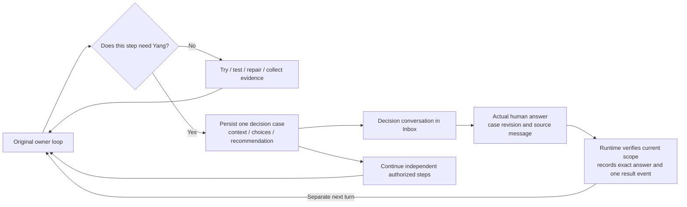

# Inbox-first attention and asynchronous decisions

Design input: Yang's supplied T3 inbox screenshot, 2026-11-12. This updates the
target workflow design, not the live desktop layout or chat-creation policy.
The screenshot is a reference, not an instruction from its author to our agents.

## Human attention is separate from execution

The daily interface should make it easy to clear the inbox rather than inspect
every working owner. Use T3's native shelves; do not build a competing sidebar.
Keep execution, business acceptance and attention as separate facts.

| Attention state | Meaning for Yang | Owner behavior |
| --- | --- | --- |
| Inbox | A decision, requested answer, important result or failure needs attention | Continue independent authorized work; isolate the actual blocking step |
| Working | Work or a monitored dependency is progressing without a human choice | Stay quiet; repair ordinary failures and try justified alternatives within scope |
| Snoozed | Defer human attention until the selected time | Background work continues; execution deadlines and human approval remain separate |
| Settled | This attention item no longer requires handling now | Record its disposition; do not infer product completion, merge permission or job cancellation |

Working should normally stay collapsed. Important completed results still need
one user-visible delivery. Settled is suitable for clearing a handled result or
decision; archival remains a later retention operation. A thread can be idle
between genuine dependency events while its business task remains ongoing.

T3 v0.1.9 already folds running/watched work into Working and supports Snooze
without pausing background work. Its native completion/failure/question behavior
can bring the original owner back to the inbox; the workflow cannot promise
that a separate decision chat alone hides the original thread. Integration must
reuse native watch/input state and reconcile desired attention through supported
client/RPC surfaces. Do not forge UI state or write T3's database directly.

Source: [T3 thread sidebar semantics](https://github.com/pingdotgg/t3code/blob/24e77473ecf41bc1f7142529c7911c1c1aae1d76/docs/user/thread-sidebar.md).

## Owner loop and decision conversation



One task keeps its execution owner. A decision conversation is a context-rich
interface for one choice, not another engineering owner or a coordinator that
approves each attempt. It may explain evidence and compare alternatives, but
does not change product files, start competing jobs, merge PRs or redelegate
the task. The original owner remains responsible for executing the answer.

The owner packages the case and proceeds without a synchronous user wait when
independent useful work exists. If all useful actions genuinely depend on the
answer, end the current turn with an explicit dependency. Keeping the core loop
alive means durable continuation on events, not endless polling or inventing
work while waiting.

Routine compile errors, fixable tests, an unchanged PR dependency, a tool with a
known authorized alternative, and a reversible implementation choice should not
create a new decision conversation. The owner should investigate and try the
reasonable alternatives first. A real tradeoff, changed goal, material external
commitment, missing approval or unresolved failure that needs Yang does belong
in Inbox. Full access is not an excuse to request routine approvals again.

## Decision case contract

Persist the case before preparing a conversation or notification:

```json
{
  "decision_id": "T-274:strategy:filtered-fts",
  "revision": 1,
  "task_id": "T-274",
  "owner_binding": {"environment_id": "...", "thread_id": "..."},
  "state": "open",
  "question": "Which materially different strategy should this accepted scope pursue?",
  "recommendation": "Option A, supported by the linked evidence",
  "options": [
    {"id": "A", "effect": "Concrete result", "tradeoff": "Concrete cost"},
    {"id": "B", "effect": "Concrete result", "tradeoff": "Concrete cost"}
  ],
  "attempted_alternatives": ["What the owner already checked and learned"],
  "blocked_steps": ["Only the step requiring this choice"],
  "independent_steps": ["Useful authorized work that can continue"],
  "validity": {"contract_rev": 4, "artifact_scope": "repo/PR/head or exact decision scope"},
  "evidence_refs": ["Original report and source evidence"],
  "conversation_ref": null,
  "answer": null
}
```

The example is a schema illustration, not an instruction to open a T-274 case.
An answer records its actual user actor, environment/thread/turn/message ID,
verbatim choice and exact case revision. An agent-authored user-role message is
not human authorization. Normal choices use their actual granted scope;
head-sensitive permissions still require the appropriate current-head checks.

Repeated observations update the existing case rather than create new chats.
Keep a stable case key for the same question; evidence changes advance its
revision. An old answer to a superseded question cannot silently authorize the
new version. Several tasks blocked by the same decision can reference one case
without merging their implementation ownership.

There is no fixed number of decisions or targets per cycle. Deduplicate real
questions; do not introduce an arbitrary four-target/two-receipt cap.

## Result delivery and user actions

| User action | Durable result | Resume behavior |
| --- | --- | --- |
| Discuss or inspect evidence | Keep the case open with added context | Owner keeps independent work moving |
| Choose an option | Bind the real answer to case revision and scope | Queue one immutable result event to the original owner |
| Snooze | Defer attention; leave the choice unanswered | Do not pause unrelated owner work or invent a default answer |
| Settle without answering | Dismiss or park attention, recording that no answer was given | Retain the unresolved blocked step; no implied approval |
| Answer becomes obsolete | Mark the scope/revision conflict | Reassess the same case using current evidence |
| Owner finishes applying the answer | Record the outcome and original receipt | Settle the handled decision item after its result is visible |

Use a stable delivery identity such as
`decision-result:<decision_id>:<revision>:<answer_message_id>`. If the owner is
busy, the result waits in T3's separate next-turn queue; never steer its current
experiment merely to deliver a choice. Delivery ACK, owner consumption and
the resulting work are separate observations. Unknown send outcomes remain
reconcilable and are not blindly resent.

Runtime should let Yang take three everyday actions: handle now, defer, or
settle. A discussion may discover a genuine followup task; normal task admission
then handles that separate scope. Clearing an inbox card alone creates no task
and does not cancel an existing one.

## Snooze versus next action time

These controls must stay independent:

- **T3 Snooze:** Yang does not want the conversation in the visible inbox yet.
  It is an attention preference; the task can continue in the background.
- **Runtime `next_action_at`:** no useful owner action is due before that time.
  Automatic work must wait even when the thread is visible and idle.
- **Explicit pause or approval:** the corresponding action is not authorized to
  proceed. Neither Snooze expiry nor a visible inbox item clears it.

The transport prototype now allows an already-authorized background message to
a snoozed thread. It still defers archived/explicitly settled targets and pending
native approvals. A future material-event wake of a settled owner requires the
business-layer reconciliation appropriate to that event, not a global un-settle.
Never implement Snooze by writing `rt_tasks.mode = paused`.

## Native surfaces and remaining implementation

T3 native side chats are useful when Yang wants to explore an owner's context
without interrupting it. In v0.1.9 they live under the original thread rather
than the sidebar, and Bring back is a user action available while the parent is
idle. They are not a drop-in autonomous decision-inbox transport. Persistent
decision conversations need ordinary T3 thread identities and a result event
back to the execution owner.

The current MCP thread-update surface supports naming and PR metadata, not a
general Inbox/Snooze/Settle mutation API. Implement attention operations through
T3's supported authenticated typed RPC or native client actions, preserving
event receipts; do not invent MCP actions. New decision conversations follow
the user's chat-creation authorization. This preparation does not create any.

Implementation order:

1. Add the decision-case ledger, immutable revisions and owner/result mapping.
2. Connect original owners' structured decision reports to the existing outbox;
   consume native human answers with their actual provenance.
3. Add the authorized conversation lifecycle and native attention/RPC adapter.
4. Verify decision-thread deduplication, stale answers, exactly-once delivery,
   restart recovery, Snooze independence and continued useful owner work.
5. Test on one real authorized case before enabling this routing broadly.

Acceptance means Yang can clear the decision inbox without monitoring every
owner, while owners continue useful work and genuine blocked steps stay visible
to the runtime. Thread count, a quiet sidebar or an empty inbox alone does not
prove workflow progress.
