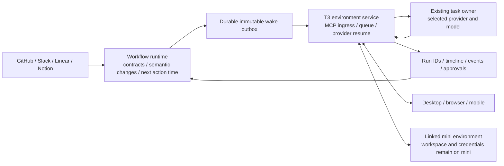

# T3 Code migration preparation

Prepared on 2026-11-12. Branch: `yang/t3code`, based on workflow main
`767f7e897f1d12a3d1b19387670a1a6526dbde69`.
Target inspected: T3 Code **v0.1.9**, commit
`24e77473ecf41bc1f7142529c7911c1c1aae1d76`.

The recommended target is a T3 environment that owns agent execution, with the
existing workflow ledger owning goals, scope, acceptance and external-action
authority. This branch contains preparation tools and a tested transport
prototype. **It does not switch the running instance or enable T3 dispatch in
the production driver.** Codex desktop main remains independently usable.

## Target architecture



There is no trigger-agent relay or UI-navigation loader on the target path.
T3 runs the queue and provider session independently of the selected UI chat.
The runtime still suppresses unchanged dependencies, respects `next_action_at`,
coalesces work and verifies substantive progress. A native server queue is useful;
the old failure was a queue tied to desktop-loaded sessions, not the existence
of a queue itself. Always send automatic work with explicit `mode: "queue"`;
T3's default `auto` can steer a busy owner.

## Use the platform's capabilities

| Capability | Target use | Verification / boundary |
| --- | --- | --- |
| Environment service | Execute without UI selection or an open desktop client | Prove cold owner start and two successive real cycles |
| Durable queue and request identity | Reuse one `clientRequestId` for an immutable wake | Preserve caller identity; ACK is acceptance, not execution |
| Durable runs and incremental history | Observe exact run/message IDs; move to event-driven updates with replay | On pruned events, reconcile a snapshot rather than assuming no change |
| Run wait | Let a bounded observer wait for an exact run | A timeout does not cancel it; waiting/approval is not completion |
| Native permission modes | Explicitly map Full access and selected model/provider/options | Verify effective thread/run settings and any caller/admin ceiling |
| PR links and stacks | Link all original task PRs to the existing owner | T3 settlement is not business acceptance, merge authority or archive authority |
| Linked environments | Route mini work to mini's own checkout and provider | No local credential, path or process substitution for a remote environment |
| Schedules and webhooks | Eventually replace UI heartbeat and compatible scheduled sources | One scheduler per occurrence; retain runtime schedules in the first pilot |
| Portable context handoff | Recover exhausted context with attributed retained history | Preserve artifacts/jobs; no automatic provider/model change or parallel writer |
| Worktrees and delegated tasks | Use native isolation and bounded child work where authorized | Do not turn each independent task into a permanent coordinator tree |
| Approvals and human input | Receive pending requests and resume the exact waiting run | Provider-specific checks remain distinct from native Full access |
| Browser/mobile clients | Review results and decisions without owning execution | Human provenance must be preserved separately from agent-authored user-role messages |

Source references: [architecture](https://github.com/pingdotgg/t3code/blob/24e77473ecf41bc1f7142529c7911c1c1aae1d76/docs/internals/overview.md),
[MCP contracts and lifecycle](https://github.com/pingdotgg/t3code/blob/24e77473ecf41bc1f7142529c7911c1c1aae1d76/docs/orchestration-v2/orchestrator-mcp-server.md),
[permissions](https://github.com/pingdotgg/t3code/blob/24e77473ecf41bc1f7142529c7911c1c1aae1d76/docs/user/permission-modes.md),
[portable handoffs](https://github.com/pingdotgg/t3code/blob/24e77473ecf41bc1f7142529c7911c1c1aae1d76/docs/user/portable-handoffs.md).

## Compatibility work

| Current component | Migration decision |
| --- | --- |
| Task catalog, goal/plan revisions, dependencies, result followthrough | Retain business semantics and original task IDs |
| Semantic event filtering and owner next-action windows | Retain; apply before a T3 submission |
| PR/head, CI/GK, personal and Functions gates | Retain; never derive human permission from a T3 status |
| `codex_app.read_thread` execution proof | Replace with a distinct authenticated T3 proof; never relabel a T3 payload as Codex evidence |
| Native trigger, CLI queue capability proof, desktop loader | Retire for migrated owners after T3 acceptance tests; retain for unmigrated owners |
| Owner creation and project/worktree attribution | Adapt to T3 project/thread IDs and explicit provider/options/modes |
| Completion delivery and archive guards | Adapt sender/result readback while keeping acceptance and exact notice identity |
| App automations | Disable only the migrated occurrence when its replacement is verified |
| Desktop-specific MCP tools | Replace chat tools with T3 tools and separately verify each connector |
| Recovery and ownership transfer | Bind task → environment → T3 thread → provider/native session; permit one writer |
| Mac-specific host/rollout permission inspection | Keep on Codex branch; T3 uses its own effective modes and provider evidence |

The current driver and guards are deeply tied to Codex UUIDs, tool envelopes,
queue ACKs and App membership. A transport-only substitution would be incorrect.
This is why the migration has its own branch rather than replacing main's
backend or weakening existing verifiers.

Slack, Notion, Linear, GitHub and Google access need individual read/write
smoke tests under T3's actual provider session. Existing App login does not
establish portability. Keep secrets in supported connector/OAuth stores or
environment variables; do not copy browser cookies or provider-session tokens.
T3 outside-agent OAuth has its own access ceiling. A read-only external token
cannot start a Full access owner.

## Preparation commands

```sh
node workflow.mjs t3 prepare --instance /path/to/existing-workflow --out /new/path/manifest.json
node workflow.mjs t3 probe --config /path/to/t3-connection.json
node --test runtime/t3-transport.test.mjs runtime/t3-preparation.test.mjs
```

`prepare` opens the original control database read-only and takes a transaction
snapshot of tasks, contracts, authority references, original owner IDs, open
executions and uncertain effects. The manifest is an inventory, not a new grant
or database backup. The output file must be new. Nothing is imported, unpaused,
sent, archived or restarted. Preserve the complete original databases and
instance-specific policy files during eventual cutover; this manifest alone is
insufficient to reconstruct them.

Copy `templates/t3-connection.example.json` outside the repository, use the MCP
URL copied from the **actual target environment**, and put an approved external
OAuth access token in its named environment variable. `probe` is read-only. It
checks capabilities, not actual execution. The preparation tool neither logs in
nor alters the running T3 service. See [outside agents](https://github.com/pingdotgg/t3code/blob/24e77473ecf41bc1f7142529c7911c1c1aae1d76/docs/user/outside-agents.md).

`runtime/t3-transport.mjs` contains a Streamable HTTP MCP client and an isolated
SQLite wake outbox. Writes default off; the public preparation CLI exposes no
send/create operation. The prototype verifies project/provider/model/mode and
native holds before dispatch, preserves an immutable request ID, uses explicit
queue mode, and proves a run from its exact complete agent-authored input.
Concurrent delivery claims use SQLite CAS. A crashed `sending` or lost reply
stays unresolved and is never automatically sent again. The prototype is not
yet connected to `rt_wakes`, the production scheduler or external delivery.

## Staged migration

1. **Inventory and connector preflight.** Verify both machines' T3 versions,
   environment/project identities, source access, selected providers/models,
   permissions, artifacts and instance-specific source differences. Keep the
   existing system running while the new path is isolated.
2. **Finish driver integration in this branch.** Introduce a typed backend
   binding per owner. Connect the T3 outbox through existing authorization,
   wait and ownership checks. Implement T3 begin/checkpoint/finish/readback,
   human-source provenance, creation and completion adapters; no fabricated
   Codex proofs. Consume live events with a persisted cursor and snapshot
   reconciliation after gaps. Explicitly surface held/blocked queues.
3. **Run an authorized isolated pilot.** Use a user-authorized test task or an
   explicitly chosen quiescent owner. Preparation itself does not create a new
   chat or appropriate a live product task. Test cold start, busy queueing,
   restart/lost reply, exact replay, two cycles and effective permissions.
4. **Transfer one finite owner.** Freeze the old writer only at a verified safe
   boundary. Preserve task identity, goal, worktree, jobs, artifacts, holds and
   all old receipts. Verify target membership and native provider-session
   mapping. Import history as context with its original provenance; T3's
   visible import is not a full transfer of tool history or workflow state.
5. **Transfer ordinary work, then service roles.** Keep each owner on exactly
   one backend. Move discovery/maintenance last, when source and completion
   integrations work. Retire only migrated trigger and loader routes. Move
   compatible schedules/webhooks afterward with occurrence-level deduplication.
6. **Repeat on mini using mini-owned state.** Keep its actual scope, daily
   schedule and holds. T3 linking is transport, not a shared filesystem or
   blanket authorization to execute another machine's tasks.

## Acceptance and rollback

| Scenario | Required evidence |
| --- | --- |
| UI closed, idle/cold owner | Exact message and real started/completed run, no window navigation |
| Busy owner | Original work finishes first; one separate queued run; no steer |
| Replay / lost reply | One command/message, stable original receipt, truthful unresolved state |
| Server restart | Durable work survives; failures/held queues remain explicit; no blind reset |
| Second cycle | New occurrence executes once after the first cycle genuinely finishes |
| Human pause or future action time | No message or wake before the registered condition permits it |
| Permissions and model | Actual effective provider/model/options/mode match the original selection |
| Connector calls | Required read and authorized write paths work from the real T3 session |
| Delivery and completion | Original owner result is read back; business acceptance remains separate |
| Ownership transfer | One writer and preserved original queue/uncertain receipts and artifacts |

T3 can hold queues after stop, failure, restart or usage limits. Its idle UI
badge or an accepted message does not prove a runnable queue. T3's event log is
pruned; the adapter must re-read persisted projections when replay is incomplete.
Automatic settlement/inactivity must not hide tasks before workflow completion
notice and acceptance. A platform context handoff also does not establish that
an existing job is safe to restart.

Rollback stops new T3 dispatch for the selected owner, reconciles all T3 effects,
and proves the target writer is quiescent before restoring its original binding.
Never merely turn the old sender back on, reset receipts, reuse another native
session ID, or restart a benchmark to make rollback appear complete.

## Current evidence and remaining work

On this host and mini, the installed CLI reports **v0.1.9**. Mini remains its own
`BubbleCal/polymarket` instance; its original modes and decision waits were only
inspected over SSH, not changed. `t3 status --json` reports
that the standalone background service is not installed; the desktop installation
can still own a server. A read-only CLI lookup did not find the current Lance
checkout as a registered T3 project. Neither observation proves a complete target
environment or credential setup. No new thread, source account login, model run,
server restart or live cutover was performed for preparation.

Local tests cover protocol framing/session headers, explicit queueing, two wake
identities, restart/replay, lost replies, target/mode/approval holds, complete
run-message proofs and read-only inventory. These are fixture/integration tests,
not measured T3 provider cold-start or connector performance. The remaining
driver/proof integration and live acceptance above are explicit migration work.
